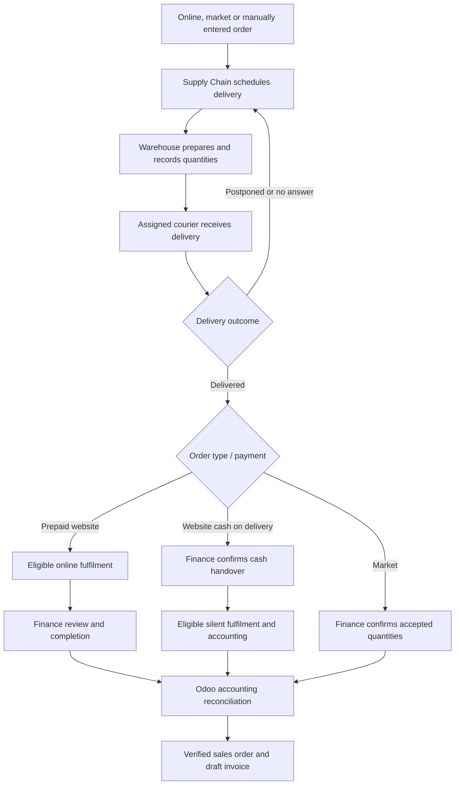

# Order-to-Delivery Operations Platform

A custom operations platform for a small consumer-goods business, covering the journey from order intake to preparation, delivery and financial reconciliation.

## The problem

Online orders, business-customer purchase orders, warehouse preparation, courier updates and financial follow-up were split across spreadsheets and separate tools. Staff needed clear, department-specific screens and a consistent order history.

## My contribution

Designed and implemented the application workflows, database, role permissions, bilingual interfaces, integration adapters, native Android applications, Windows desktop wrapper, reporting and deployment tooling. Development included AI-assisted implementation and iterative testing with operational users.

## Implemented capabilities

- Shopify order intake and delivery/payment-gated silent fulfilment.
- Odoo market quotation intake and sales-order/draft-invoice reconciliation.
- Stock reservations, dated batches, expiry visibility, preparation and actual sent/received quantities.
- A courier Android app with product photos, simple status actions, WhatsApp draft links, remembered sign-in and permission-based delivery location sharing.
- A separate Production Android app for made-to-order work and shortages; background push is a configured integration.
- Finance cash handovers, courier balances and market receipt reconciliation.
- Arabic/English interfaces, department permissions, audit trails and spreadsheet-style reporting.
- Docker deployment configuration, automated checks and backup/restore tooling.

## Stack

Django REST Framework · PostgreSQL · Redis · Celery · React · TypeScript · Android Java · Windows WebView2 · Docker · Caddy

## Order workflow

## Verification and delivery status

The system has been exercised in a local container environment, including PostgreSQL-backed automated tests, controlled provider tests, real Android trials and an isolated database restore. Production hosting, final employee acceptance and some external setup remain separate release gates. No claim of production scale, measured business savings or completed live rollout is made.

## Confidentiality

This public description contains no employer name, customer records, actual order values, credentials, proprietary images or source code. The implementation repository remains private. A demonstration for prospective clients should use synthetic data and permission-cleared branding/assets.

## Services this project demonstrates

Custom internal systems · inventory and delivery workflows · Shopify/Odoo integration · Android business apps · bilingual dashboards · reporting and automation.
