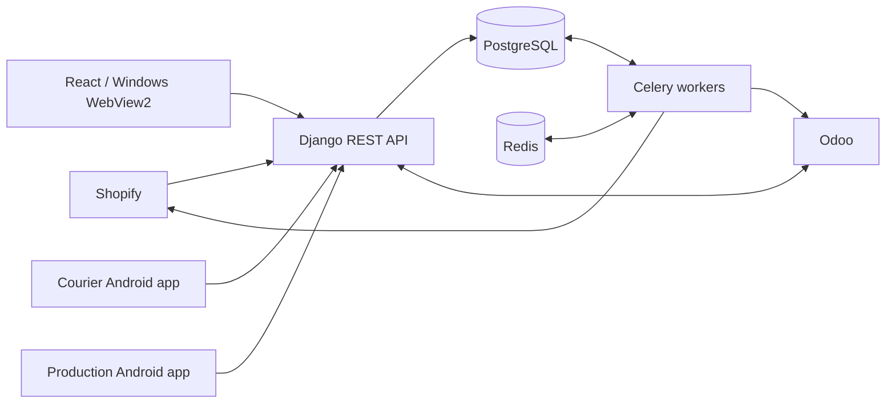

# Order-to-Delivery Operations Platform

A bilingual operations platform connecting order intake, inventory, warehouse preparation,
courier delivery, production and financial reconciliation. Built by Youssef Haitham.

This repository contains the **sanitized application source**, including the backend,
web interface, Android apps, Windows wrapper, automated tests and deployment templates.
Company branding, operational data and account-specific setup are excluded. Demo assets
and fixtures are synthetic. This is a portfolio release, not a claim of production readiness.

## Capabilities

- Shopify order intake and payment/delivery-gated fulfilment.
- Odoo quotation intake and sales-order/draft-invoice reconciliation.
- Stock reservations, batches, expiry dates and warehouse dispatch quantities.
- Courier Android app with order actions, product photos and permission-based location sharing.
- Production Android app for made-to-order work and shortages.
- Finance cash handovers, courier balances and accepted-quantity reconciliation.
- Arabic/English screens, department permissions, audit trails and spreadsheet exports.

## Architecture



**Stack:** Django REST Framework, PostgreSQL, Redis, Celery, React, TypeScript,
native Android Java, Windows WebView2, Docker and Caddy.

## Run locally

Requires Docker with Linux containers and Compose v2. The initialization script uses PowerShell 7.

```powershell
./scripts/init-local.ps1
docker compose config --quiet
docker compose up --build -d
docker compose exec api python manage.py bootstrap_roles
docker compose exec api python manage.py createsuperuser
```

Open http://localhost:8080 and sign in with the account you created. No default accounts
or business records are distributed. Configure warehouses, products, roles and inventory
in your own environment. The initialization script generates fresh local secrets.

External integrations are optional and unconfigured. Shopify and Odoo credentials, URLs,
customer/product mappings, and any Firebase setup must come from accounts you control.
External writes are disabled by default in `.env.example`. Never use production accounts for tests.

## Repository map

| Path | Contents |
| --- | --- |
| `backend/` | API, permissions, workflows, integrations, migrations and tests |
| `frontend/` | React/TypeScript department workspaces |
| `android/` | Courier and production apps |
| `windows/` | WebView2 desktop wrapper |
| `infra/` | Container and proxy configuration |
| `scripts/` | Initialization, builds, backup and source-audit tools |
| `docs/` | Public setup, security and verification notes |

## Development checks

From `backend/`, install `requirements-dev.txt`, supply isolated test environment values,
and run `python manage.py check`, `pytest -q`, and `python -m ruff check .`.
PostgreSQL is required for deployment and concurrency testing. The explicit
`config.settings_test` configuration supports portable SQLite checks; it is not a deployment setting.

From `frontend/`, use the pinned package manager: `pnpm install --frozen-lockfile` and `pnpm build`.
GitHub Actions defines PostgreSQL-backed backend checks and the frontend build.
See [verification](docs/verification.md) for checks performed on this sanitized copy.

## Further reading

- [Public case study](PORTFOLIO.md)
- [Integration configuration](docs/integrations.md)
- [Deployment](docs/deployment.md) and [mobile builds](docs/mobile-distribution.md)
- [Sanitization scope](docs/public-source.md) and [security](SECURITY.md)

No Shopify or Odoo account access, customer records, store data or third-party proprietary
code is included. Third-party dependencies retain their own licenses; bundled fonts include their OFL notice.
